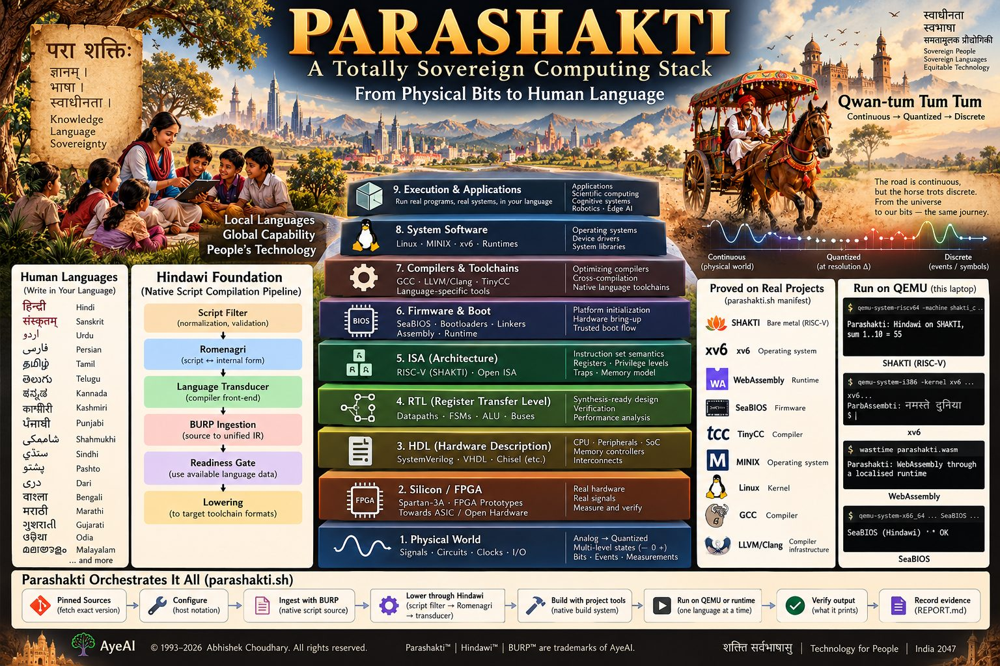
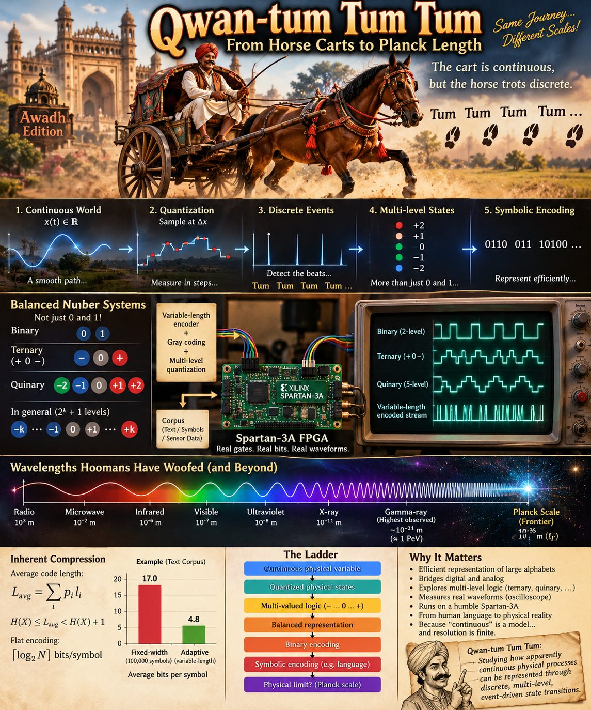
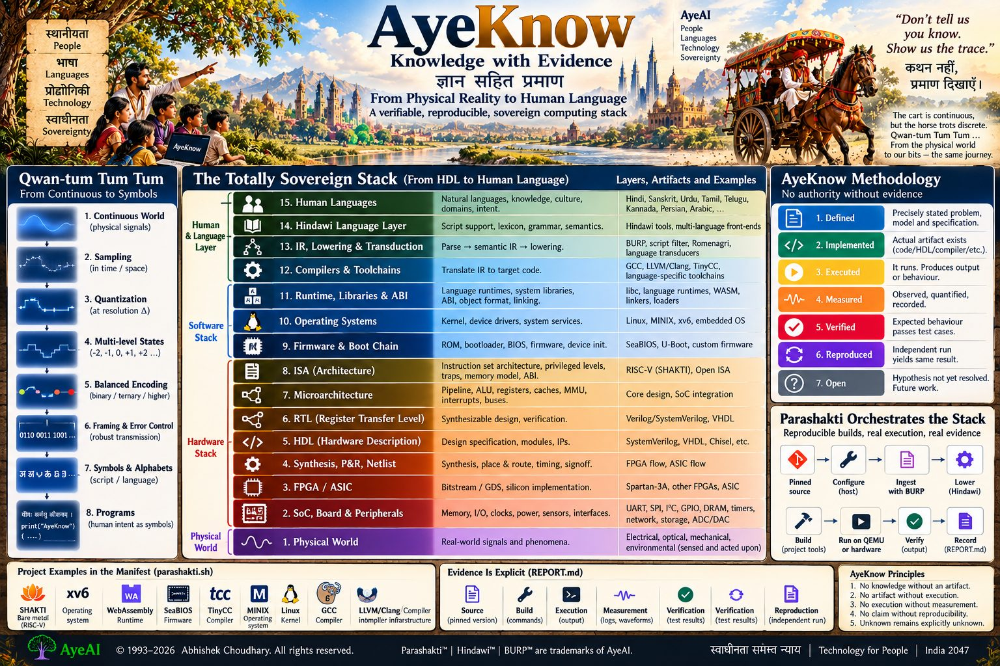
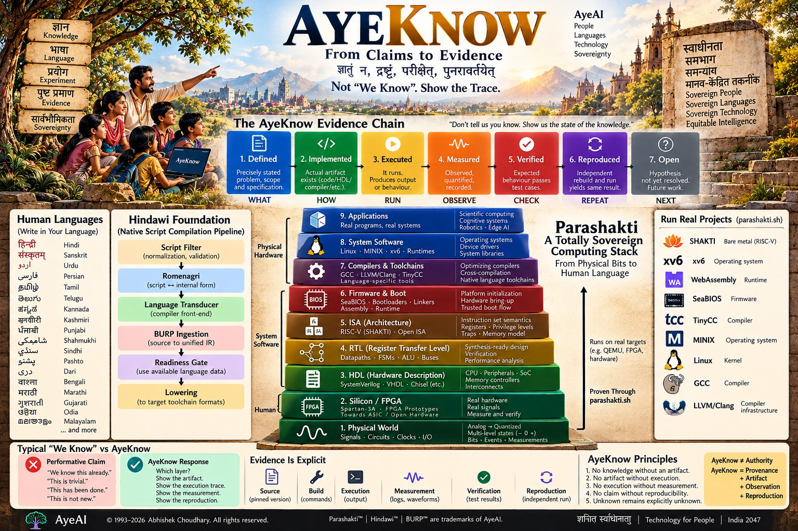
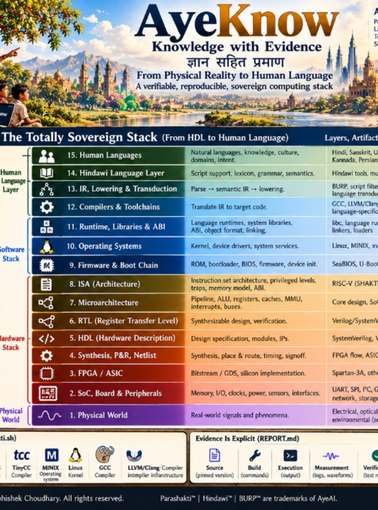

# Hindawi 2026.10

DOI: [10.5281/zenodo.23469266](https://doi.org/10.5281/zenodo.23469266)

© 1993–2026 Abhishek Choudhary. All rights reserved. AyeAI.

Hindawi lets people program in their own language and script, from application code down to firmware. This release
carries Hindawi's shaili toolchains for 76 languages, and BURP, the Bidirectional Universal Resource Parser, which
ingests any existing project into any number of languages at once and reverses it byte for byte.

**Start here.** `bash install.sh` checks what Hindawi needs, builds the Hindawi toolchain from the pinned source,
puts `hindawi` and `hindawicc` on your PATH, and proves the installation by compiling a program from Urdu and from
Telugu. Then `hindawi --help`, `man hindawi`, and `docs/hindawi/MANUAL.md`, which says how to work on this and where
every tool lives. `VERIFY.md` is the manual verification, step by step, with the result each step should give.

- **Can a language survive the whole computing stack?** `docs/trace/` is the explainer site: one character, in any
  script, followed from human language through encoding, compilers and machines to the physical signal and back, with
  every layer's evidence state (AyeKnow) and the posters below.
  `docs/trace/machine.html` opens the machine: APCISR's original algorithm (compiled to WebAssembly, byte for byte the
  native build's) forming the letters on its 9-grid, an 80 × 60 text-mode screen, graphics mode, the framebuffer, the DAC
  or digital link, and GPUs, GPGPU, CUDA and AI.
- **Trademarks, credits and the work.** `legal/TRADEMARKS.md` asserts the marks (AyeAI®, AyeCNSe® and AyeAM® are
  registered in India); code licences grant copyright permissions only. `CREDITS.md` keeps the originator's credit.
  `TASKS.md` is every open task and standing covenant; each open task is a work package anyone can claim from
  `docs/hindawi/work-packages.html`.
- **Standards.** `standards/<language>/standard.{md,docx}`: draft proposals for LITD 15 of the Bureau of Indian
  Standards, written to Indian Standard drafting practice, only for languages whose keyword bindings are complete.
- **Proposals.** `docs/hindawi/PANIR.md` (the intermediate representation) and `docs/hindawi/TOOLS-PROPOSED.md`.
- **Ingestion (BURP).** `hindawi ingest SRC --langs all --out OUT`. Keywords come from each
  language's own transducers; names and comments are translated into a dictionary kept with the project, using
  whichever translators are installed (glossary, Argos Translate, a local language model, any command). Application
  work needs nothing more. See `docs/hindawi/BURP.md`.
- **Compilation, down to firmware.** `lang/hindawi/hindawicc` is a drop-in gcc. It compiles on the transliterated
  (Romenagri) form, so native names survive to the symbol table and the debugger. This is needed only at the lowest
  layers.
- **Editors.** The Arduino IDE (`ide/arduino/install.sh`: students program their boards in their own language),
  Eclipse (`ide/eclipse/`), Geany, and gdb with native names (`ide/gdbinit`). See `docs/hindawi/IDE.md`.
- **Notebooks, one per language.** `docs/hindawi/notebooks.html` opens each in Colab: installation, the Hindawi NB UI
  practice area with loadable demos, and for each shaili the program, input, the whole compilation flow, execution and
  Std2Hin, after Chintamani's notebook. 47 languages, each verified by building its demos through the original pipeline.
- **Standards, work packages and notebooks.** `standards/` holds each language's standard in Markdown, JSON and Word;
  `work-packages/` the open work anyone can claim (`docs/hindawi/work-packages.html`); `notebooks/` the Colab notebooks
  in each language (`docs/hindawi/notebooks.html`).
- **Samples.** `samples/gate/`: programs for every programming domain GATE covers, in C with Python, Java, C++ and
  BASIC beside them. `hindawi gate --langs sanskrit` ingests them into a language, compiles each C program
  from that language through the original pipeline and checks it prints what the English one prints. What each
  program teaches, against the GATE syllabus, is in `docs/hindawi/GATE-PROGRAMS.md`. The sets are on the site beside the English one: `docs/hindawi/samples/index.html`.
- **Your language's standard.** Review it construct by construct and paradigm by paradigm, from hardware description
  to robots and AI, on `docs/hindawi/review.html`; each proposal is an issue here. Each language's gaps are in its
  cell's `STATUS.tsv`.
- **The linguistics lab.** `docker compose -f lab/docker-compose.yml up --build`: JupyterLab, the review pages, Praat
  and Argos Translate, with Hindawi built inside. See `lab/README.md`.
- **The sovereign stack.** `scripts/sovereign/stack.sh --list`, then one stage at a time.
- **What changed, and where this departs from earlier Hindawi.** `CHANGE-LOG.md`, `docs/hindawi/DEVIATIONS.md`.

The Sanskrit parser (Pushkalāvatī, Sūtram) that shares this tree has its own home in hindawiai/sanskrit; this
tree's earlier README is kept at `docs/history/README-BUILD-0102.md`.

## Products

What each product is for, how to get it, what is shown to work and what remains before release: `PRODUCTS.md`. To practise
on a phone, open a notebook in Colab: [Urdu](https://colab.research.google.com/github/hindawiai/hindawi2026.10/blob/main/notebooks/practice/hindawi_urdu.ipynb), [Hindi](https://colab.research.google.com/github/hindawiai/hindawi2026.10/blob/main/notebooks/practice/hindawi_hindi.ipynb), [Punjabi](https://colab.research.google.com/github/hindawiai/hindawi2026.10/blob/main/notebooks/practice/hindawi_punjabi.ipynb), [Punjabi Shahmukhi](https://colab.research.google.com/github/hindawiai/hindawi2026.10/blob/main/notebooks/practice/hindawi_punjabi_shahmukhi.ipynb), [Sindhi](https://colab.research.google.com/github/hindawiai/hindawi2026.10/blob/main/notebooks/practice/hindawi_sindhi.ipynb), [Telugu](https://colab.research.google.com/github/hindawiai/hindawi2026.10/blob/main/notebooks/practice/hindawi_telugu.ipynb), [Kannada](https://colab.research.google.com/github/hindawiai/hindawi2026.10/blob/main/notebooks/practice/hindawi_kannada.ipynb), [Sanskrit](https://colab.research.google.com/github/hindawiai/hindawi2026.10/blob/main/notebooks/practice/hindawi_sanskrit.ipynb), [Dari](https://colab.research.google.com/github/hindawiai/hindawi2026.10/blob/main/notebooks/practice/hindawi_dari.ipynb), [Pashto](https://colab.research.google.com/github/hindawiai/hindawi2026.10/blob/main/notebooks/practice/hindawi_pashto.ipynb).

## Posters

The posters state the intent of the work. Each claim on them is listed with its evidence state on the
[explainer site](docs/trace/index.html#posters): verified where this repository shows it, open where it is not yet shown.
Images made with generative tools are illustrations; their figures and console text are not measurements.

| | |
|---|---|
|  |  |
|  |  |
|  | |
